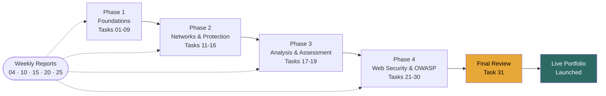
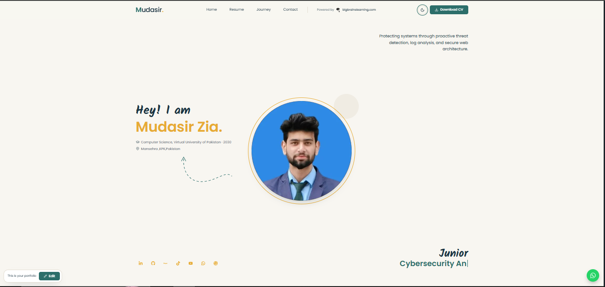
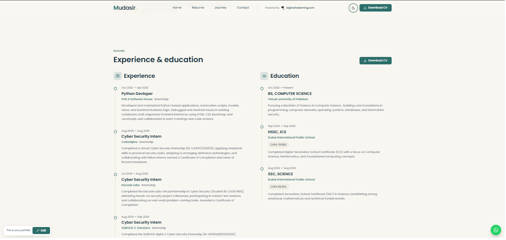
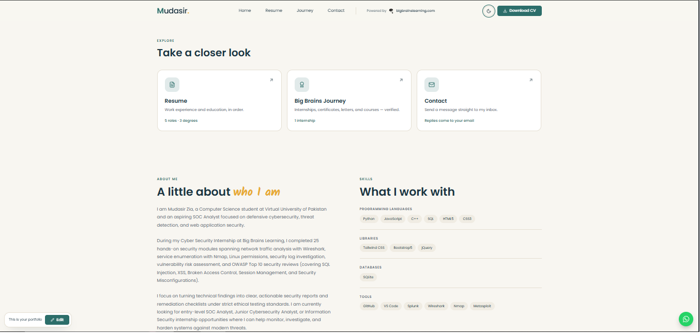

# 🛡️ Big Brains Learning: Cybersecurity Internship

**25+ hands-on security modules: network analysis, vulnerability assessment, and OWASP Top 10 web security.**

### 👉 [**VIEW LIVE PORTFOLIO**](https://www.bigbrainslearning.com/portfolio/mudasirzia) 👈

**Intern:** Mudasir Zia · **GitHub:** [@CyberBros435](https://github.com/CyberBros435)

---

## 📌 Overview

This repository holds every deliverable from my Cyber Security Internship at **Big Brains Learning**: practical task submissions, weekly LinkedIn showcase reports, and a final review report. The work progresses from security fundamentals (networking, Linux, passwords, hashing, phishing) to applied defensive work (Wireshark traffic analysis, Nmap enumeration, vulnerability risk assessment, log analysis) and finishes with OWASP Top 10 web security reviews.

### Key Takeaways
- Completed **25 hands-on security modules** with written, documented submissions.
- Turned technical findings into **clear security reports and remediation checklists**.
- Worked under **strict ethical testing standards**.
- Published **weekly progress reports** and a **live public portfolio**.

---

## 🧰 Skills & Technologies

| Category | Skills |
|---|---|
| **Network Security** | Wireshark traffic analysis · Nmap scanning & service enumeration · IP/ports/protocols · Firewalls |
| **Systems** | Linux commands · File permissions · Safe file handling |
| **Defensive Security** | Security log investigation · Vulnerability risk assessment · Malware awareness · Phishing identification |
| **Web Security (OWASP)** | SQL Injection · XSS · Broken Access Control · Session Management · Security Misconfiguration |
| **Professional** | Technical reporting · Remediation checklists · Ethical testing plans · LinkedIn showcase reports |

---

## 🗺️ Learning & Deliverable Roadmap

---

## 📑 Index of Tasks & Weekly Reports

| # | Deliverable / Report Title | Category | Document Link |
|---|---|---|---|
| 01 | Learn the Basics of Cybersecurity | Technical Task | [View PDF](./01_Learn%20the%20Basics%20of%20Cybersecurity%20-%20Practical%20Task%20Submission.pdf) |
| 02 | Understand How the Internet and Networks Work | Technical Task | [View PDF](./02_Understand%20How%20the%20Internet%20and%20Networks%20Work%20-%20Task%20Submission.pdf) |
| 03 | Learn Basic Linux Commands | Technical Task | [View PDF](./03_Learn%20Basic%20Linux%20Commands%20-%20Practical%20Task%20Submission.pdf) |
| 04 | Weekly LinkedIn Showcase Report (Week 1) | Weekly Report | [View PDF](./04_Weekly%20LinkedIn%20Showcase%20Report.pdf) |
| 05 | Understand Password Security and Multi-Factor Authentication | Technical Task | [View PDF](./05_Understand%20Password%20Security%20and%20Multi-Factor%20Authentication%20-%20Task%20Submission.pdf) |
| 06 | Learn the Difference Between Hashing and Encryption | Technical Task | [View PDF](./06_Learn%20the%20Difference%20Between%20Hashing%20and%20Encryption%20-%20Task%20Submission.pdf) |
| 07 | Common Cybersecurity Threats | Technical Task | [View PDF](./07_Common%20Cybersecurity%20Threats%20-%20Task%20Submission.pdf) |
| 08 | Learn How to Identify Phishing Emails and Messages | Technical Task | [View PDF](./08_Learn%20How%20to%20Identify%20Phishing%20Emails%20and%20Messages%20-%20Task%20Submission.pdf) |
| 09 | Understand Web Browsers, HTTP, and HTTPS | Technical Task | [View PDF](./09_Understand%20Web%20Browsers%2C%20HTTP%2C%20and%20HTTPS%20-%20Task%20Submission.pdf) |
| 10 | Week 2 LinkedIn Showcase Report | Weekly Report | [View PDF](./10_Week2_LinkedIn_Showcase_Report_Mudasir_Zia.pdf) |
| 11 | Understand IP Addresses, Ports, and Network Protocols | Technical Task | [View PDF](./11_Understand%20IP%20Addresses%2C%20Ports%2C%20and%20Network%20Protocols%20-%20Task%20Submission.pdf) |
| 12 | Learn How to Protect Files and Manage Permissions | Technical Task | [View PDF](./12_Learn%20How%20to%20Protect%20Files%20and%20Manage%20Permissions%20-%20Task%20Submission.pdf) |
| 13 | Understand Malware and Safe File Handling | Technical Task | [View PDF](./13_Understand%20Malware%20and%20Safe%20File%20Handling%20-%20Task%20Submission.pdf) |
| 14 | Firewalls and Basic Network Protection | Technical Task | [View PDF](./14_Firewalls_and_Basic_Network_Protection_Submission.pdf) |
| 15 | Week 3 LinkedIn Showcase Report | Weekly Report | [View PDF](./15_Week3_LinkedIn_Showcase_Report_Mudasir_Zia.pdf) |
| 16 | Complete Your First Cybersecurity Review | Technical Task | [View PDF](./16_Complete%20Your%20First%20Cybersecurity%20Review%20-%20Task%20Submission.pdf) |
| 17 | Network Traffic Analysis Report (Wireshark) | Technical Task | [View PDF](./17_Network%20Traffic%20Analysis%20Report%20-%20Wireshark%20Task%20Submission.pdf) |
| 18 | Network Scanning and Service Enumeration Report | Technical Task | [View PDF](./18_Network%20Scanning%20and%20Service%20Enumeration%20Report%20-%20Task%20Submission.pdf) |
| 19 | Vulnerability Risk Assessment Report | Technical Task | [View PDF](./19_Vulnerability%20Risk%20Assessment%20Report%20-%20Task%20Submission.pdf) |
| 20 | Weekly LinkedIn Showcase Report (Week 4) | Weekly Report | [View PDF](./20_Weekly%20LinkedIn%20Showcase%20Report%20-%20Week%204.pdf) |
| 21 | OWASP Web Security Research Report | Technical Task | [View PDF](./21_OWASP%20Web%20Security%20Research%20Report%20-%20Task%20Submission.pdf) |
| 22 | Security Log Analysis Report | Technical Task | [View PDF](./22_Security%20Log%20Analysis%20Report%20-%20Task%20Submission.pdf) |
| 23 | Ethical Security Testing Plan | Technical Task | [View PDF](./23_Ethical%20Security%20Testing%20Plan%20-%20Task%20Submission.pdf) |
| 24 | Web Security Lab Setup Report | Technical Task | [View PDF](./24_Web%20Security%20Lab%20Setup%20Report%20-%20Task%20Submission.pdf) |
| 25 | Weekly LinkedIn Showcase Report (Week 5) | Weekly Report | [View PDF](./25_Weekly%20LinkedIn%20Showcase%20Report%20-%20Week%205.pdf) |
| 26 | Login and Session Security Review | Technical Task | [View PDF](./26_Login%20and%20Session%20Security%20Review%20-%20Task%20Submission.pdf) |
| 27 | SQL Injection Awareness Report | Technical Task | [View PDF](./27_SQL%20Injection%20Awareness%20Report%20-%20Task%20Submission.pdf) |
| 28 | Cross-Site Scripting Security Report | Technical Task | [View PDF](./28_Cross-Site%20Scripting%20Security%20Report%20-%20Task%20Submission.pdf) |
| 29 | Access Control Review | Technical Task | [View PDF](./29_Access%20Control%20Review%20-%20Task%20Submission.pdf) |
| 30 | Web Security Configuration Review | Technical Task | [View PDF](./30_Web%20Security%20Configuration%20Review%20-%20Task%20Submission.pdf) |
| 31 | Internship Feedback and Review Report | Final Report | [View PDF](./31_Internship%20Feedback%20and%20Review%20Report%20-%20Task%20Submission.pdf) |

---

## 🚀 Final Capstone: Live Portfolio Showcase

The capstone deliverable is my official, publicly hosted portfolio: resume, verified internship journey, skills, and contact form.

### 🔗 [**https://www.bigbrainslearning.com/portfolio/mudasirzia**](https://www.bigbrainslearning.com/portfolio/mudasirzia)

### Preview

  

<em>Home: introduction and focus on proactive threat detection and secure web architecture</em>

  

<em>Resume: experience and education timeline</em>

  

<em>About &amp; Skills: Wireshark, Nmap, Splunk, Python, OWASP-focused security work</em>

<!-- b2.png is blank. Re-upload a valid screenshot, then uncomment:

  

-->

---

**Mudasir Zia** · Aspiring SOC Analyst · [GitHub](https://github.com/CyberBros435) · [Live Portfolio](https://www.bigbrainslearning.com/portfolio/mudasirzia)

